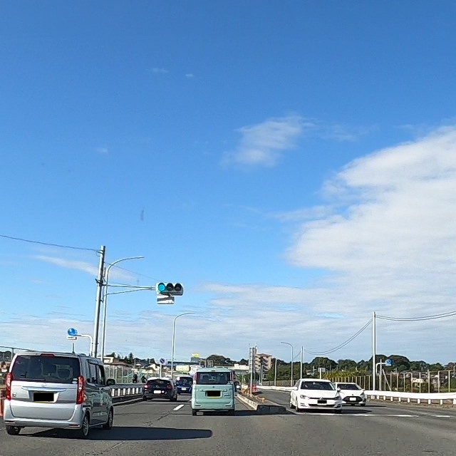
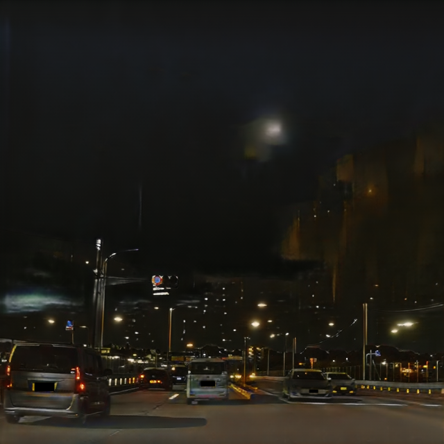
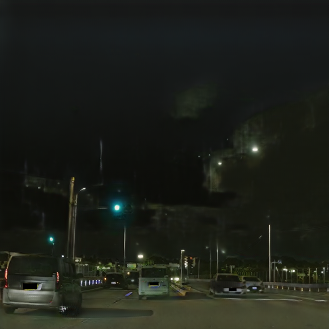
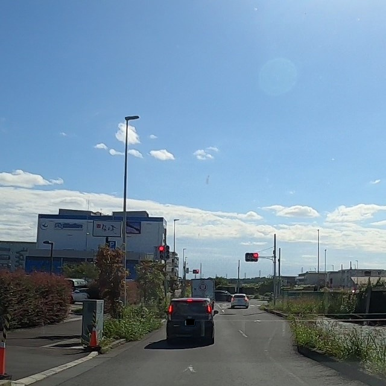
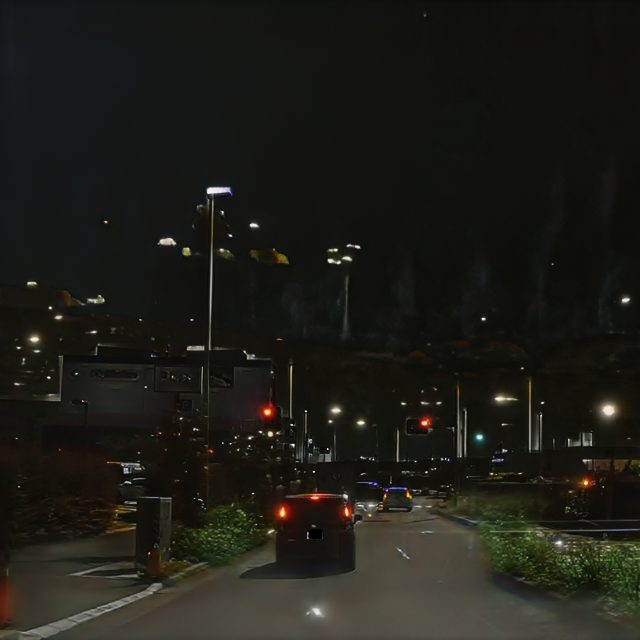
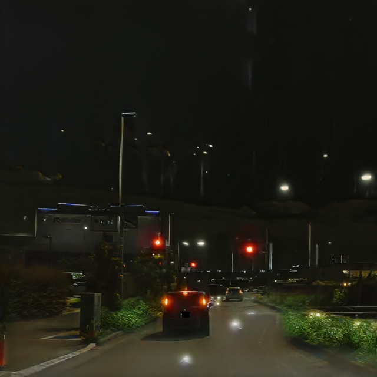
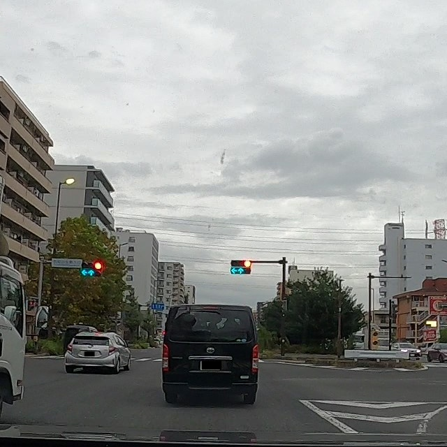
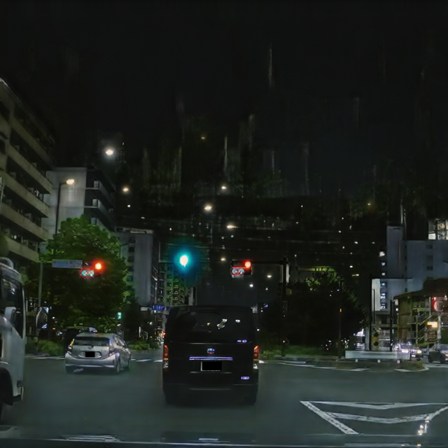
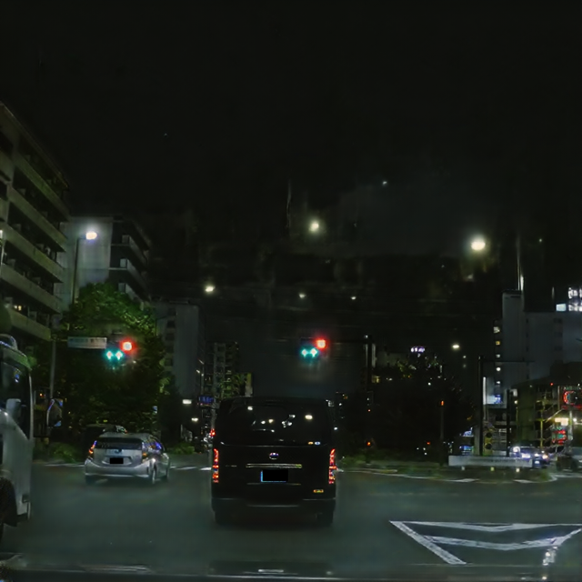

# Local Crop CycleGAN

**Local Crop CycleGAN** は、[junyanz/pytorch-CycleGAN-and-pix2pix](https://github.com/junyanz/pytorch-CycleGAN-and-pix2pix) をベースに、
**YOLO 形式のバウンディングボックスを使って小物体（信号機など）の領域だけに追加の GAN 損失をかける**
よう拡張した CycleGAN です（用途例: 昼→夜変換）。**このREADMEでは昼→夜変換を例に説明します。**

昼画像（ドメイン A）を夜画像（ドメイン B）に変換する際、信号機のような小物体は画像全体の 1% 未満の画素しか
占めないため、大域の GAN 損失や cycle 損失にはほとんど寄与しません（勾配の希釈）。その結果、
「画像全体は夜らしいが、信号機が光っていない／色が変わっている」といった破綻が起きます。
Local Crop CycleGAN は物体の周辺を切り出したクロップ専用の局所 Discriminator を追加し、この問題を直接補償します。

> **用語: local crop（局所クロップ）**
> 本 README で「local crop」と呼ぶのは、各 bbox の中心に合わせて余白付きで切り出した正方形の局所コンテキスト窓のことです。
> データ拡張としての画像クロップ（`--preprocess crop` や object-aware crop）とは別物で、本拡張で追加した局所 Discriminator への入力としてのみ使います。
>
> **用語: 前処理クロップ**
> 元の CycleGAN がデータ読み込み時に行う、`--preprocess crop` 系（`resize_and_crop` など）による `--crop_size` の切り出しを、本 README では「前処理クロップ」と呼びます。
> 学習・テストに使う画像そのものを作る処理で、local crop とは別物です。object-aware crop は、この前処理クロップの位置の選び方を変える拡張です。

`--lambda_local 0`（既定値）のときは局所 D を一切作らないため、**素の CycleGAN と完全に同じ挙動**になります。

---

## 変換結果（昼 → 生成した夜）

<!--
  画像の差し替え方:
    1. 学習済みモデルで test.py を実行する（下記「テスト」節を参照）
    2. results/<name>/test_latest/images/ に出力される
         xxx_real_A.png（入力の昼画像） / xxx_fake_B.png（生成した夜画像）
       を imgs/day2night/ にコピーし、下表のファイル名に合わせてリネームする
    3. 行を増やす場合は <tr> ブロックをコピーする
-->

<table>
  <tr>
    <th align="center">入力（昼）</th>
    <th align="center">CycleGAN（ベースライン）</th>
    <th align="center">Local Crop CycleGAN</th>
  </tr>
  <tr>
    <td></td>
    <td></td>
    <td></td>
  </tr>
  <tr>
    <td></td>
    <td></td>
    <td></td>
  </tr>
  <tr>
    <td></td>
    <td></td>
    <td></td>
  </tr>
</table>

ベースラインとの比較が不要な場合は、中央の列を削除して「昼 → 夜」の 2 列にしてください。

---

## 主な変更点

| 対象 | 内容 |
| --- | --- |
| `data/unaligned_labeled_dataset.py`（新規） | YOLO ラベル付きの unpaired データセット。画像と同一の幾何変換（リサイズ・前処理クロップ・左右反転）をラベルにも適用する |
| `data/base_dataset.py` | `get_transformed_size` / `load_yolo_txt` / `transform_yolo_labels` を追加。`get_params` に object-aware crop を追加 |
| `data/__init__.py` | データセットが `collate_fn` を持つ場合はそれを DataLoader に渡す（可変長ラベル対応） |
| `models/networks.py` | 局所 D `LocalDiscriminator`（クラス／スケール条件付きの projection discriminator）と `define_local_D` を追加 |
| `models/cycle_gan_model.py` | 局所 GAN 損失、クロップ抽出、採用率ログ、クロップ可視化を追加 |
| `scripts/dump_local_crops.py`（新規） | 学習前に、局所 D に渡るクロップを画像として保存し確認するツール |
| `scripts/inspect_label_scripts.py`（新規） | bbox の長辺分布を集計し、`--local_ctx_sizes` の決め方を支援するツール |

### 手法の概要

```
real_A (昼) ──G_A──> fake_B (夜) ──G_B──> rec_A
   │                    │
   │ labels_A           │ labels_A の位置でクロップ
   │                    v
   │              [局所窓] ──resize──> D_A_local(crop, class, scale) <── real_B の物体クロップ
   │
   └─ 大域 D_A / cycle 損失 / identity 損失（従来どおり）
```

- **局所コンテキスト窓**: 各 bbox に対して「長辺 + `local_ctx_pad` 以上で最小の窓サイズ」を `--local_ctx_sizes` の候補から割り当て、
  物体中心で正方形に切り出します。夜間のハロー・ブルームは bbox の外側に広がるため、余白付きで切り出します。
  最大窓に収まらない bbox や、窓が画像外にはみ出す bbox は除外されます。
- **スケール条件付け**: 切り出した窓は `--local_d_size` に統一リサイズして局所 D に渡します。
  グロー半径は絶対ピクセルで決まるため、窓サイズ（バケット ID）を条件として与え、スケールごとの統計が混ざらないようにします。
- **クラス条件付け**: クラス ID を条件として与えることで、「夜らしいがクラスと色が一致しない」生成（赤信号が緑になる等）を fake と判定できます。
  検出器のデータ拡張用途ではこの種のラベルノイズが致命的になるためです。
- **局所 D の構造**: 受容野 34px 程度の浅い PatchGAN 特徴 + global average pooling + projection 項
  （Miyato & Koyama, *cGANs with Projection Discriminator*, ICLR 2018）。
  正規化層の既定は `none` です（InstanceNorm は絶対輝度を消してしまい、自発光物体に不向きなため）。
- **生成側クロップの位置**: `fake_B = G_A(real_A)` の幾何は `real_A` に従うので、`labels_A` の位置で切り出します。B→A 方向も同様です。
- **片側 0 件時のスキップ**: real / fake どちらか一方のクロップが 0 件の反復では、局所 D の損失を 0 にします（D の偏り防止。DDP でもデッドロックしないようダミー入力で forward のみ通します）。
- **object-aware crop**: 学習時に、物体が学習用画像に残るように前処理クロップ（元の CycleGAN のクロップ）の位置を選びます。詳細は次節を参照してください。

### object-aware crop

object-aware crop は、元の CycleGAN の前処理クロップ（データ拡張）で学習用画像を切り出す位置を、一様ランダムではなく
**物体（bbox）を含むように** 選ぶ仕組みです。実装は `data/base_dataset.py` の `get_params` / `_select_target_box` / `_sample_crop_origin` にあります。

#### なぜ必要か

元の CycleGAN は学習時に画像を `--load_size` にリサイズした後、`--crop_size`（例: 256px）の正方形をランダムな位置で切り出します（前処理クロップ）。
信号機のような小物体は画像のごく一部にしか写っていないため、一様ランダムな前処理クロップでは高頻度で物体が切り落とされます。

```
リサイズ後の元画像
┌──────────────────────────────┐
│                       [信号]  │
│  ┌────────┐                  │  <- 一様ランダムだと、物体を含まない位置が選ばれやすい
│  │前処理  │                  │
│  │クロップ│                  │
│  └────────┘                  │
└──────────────────────────────┘
```

物体を含まない学習用画像からは local crop を 1 枚も作れないため、局所損失がかからず、
real / fake 片側 0 件による局所 D の更新スキップも増えます。object-aware crop はこれを防ぎ、局所 D に渡るサンプル数を確保します。

#### 動き方

`--object_aware_crop_p`（既定値 0.5）の確率で以下を行い、残りの確率では従来どおり一様ランダムに切り出します。

1. **狙う bbox を 1 つ選ぶ**（`_select_target_box`）
   局所損失に実際に使える bbox だけを候補にし、その中からランダムに 1 つ選びます。次の bbox は候補から除外します。
   - `--local_ctx_sizes` のどの窓にも収まらない（長辺 + `--local_ctx_pad` が最大窓を超える）bbox
   - 割り当てられる窓が `--crop_size` より大きい bbox

   これらを狙っても、モデル側の `_extract_crops` で除外されるだけで空振りになるためです。候補が無い画像では一様ランダムに戻ります。
2. **前処理クロップの原点をサンプルする**（`_sample_crop_origin`）
   選んだ bbox の中心が前処理クロップの端から `margin` 以上内側に入る範囲で、原点を一様にサンプルします。
   `margin` は「その bbox に割り当てられる窓サイズの半分」と `--object_crop_margin` の大きい方で、
   これにより local crop の窓全体が学習用画像の中に収まります。
   物体を常に中央に置くのではなく範囲内でランダムに配置するので、物体位置の多様性は保たれます。
3. **ラベルに同じ変換を適用する**
   決めた前処理クロップの位置と左右反転は、`transform_yolo_labels` で YOLO ラベルにもそのまま適用されます。

#### 設計上の注意点

- **A / B 両ドメインに同じポリシーを適用する**
  片方のドメインだけ物体を含みやすくすると、前処理クロップの位置の分布がドメイン間でずれ、
  大域 D が「物体の有無」でドメインを見分けるショートカットを学習してしまいます。
- **テスト時は自動的に無効になる**
  `opt.isTrain` が False のときは確率 0（一様ランダム）になります。評価用の画像が「物体を含む」方向に偏ると、
  素の CycleGAN との比較が公平でなくなるためです。
- **`--local_ctx_sizes` / `--local_ctx_pad` はモデル側と共有される**
  データセットはモデルのオプションを参照して窓サイズを計算するので、個別に揃える必要はありません。
- **効果の確認**
  `scripts/dump_local_crops.py` の出力や `local_crop_log.txt` で「画像外」による除外が多い場合は、
  `--object_aware_crop_p` を上げるか、前処理クロップのサイズ `--crop_size` を大きくしてください。

#### local crop との違い

| | object-aware crop | local crop |
| --- | --- | --- |
| タイミング | データ読み込み時（前処理） | 学習の損失計算時 |
| 切り出すもの | 元画像から `crop_size` の学習用画像（元の CycleGAN の前処理クロップ） | 学習用画像から bbox 中心の局所窓 |
| 目的 | 学習用画像に物体が残るようにする | 局所 D に物体周辺だけを見せる |
| 関係 | local crop を作れる確率を上げるための下準備 | 局所損失の計算に使う本体 |

---

## データセットの準備

`--dataset_mode unaligned_labeled` を使います。ラベルは YOLO 形式（1 行 `cls xc yc w h`、すべて正規化座標）です。

```
<dataroot>/
├── trainA/            # 昼画像
├── trainA_labels/     # 昼画像の YOLO ラベル（画像と同じ相対パス、拡張子 .txt）
├── trainB/            # 夜画像
├── trainB_labels/     # 夜画像の YOLO ラベル
├── testA/
└── testB/
```

- ラベルディレクトリは `--label_dir_A` / `--label_dir_B` で任意の場所を指定できます。
  未指定時は `<dataroot>/<phase>A_labels`、それも無ければ画像と同じディレクトリを探します。
- ラベルファイルが無い画像は「物体なし」の正当なサンプルとして扱います（起動時に件数を警告表示します）。
- `--lambda_local > 0` なのにラベルを返さないデータセット（`unaligned` 等）を指定した場合は、最初のバッチでエラー終了します。

---

## 使い方

### 1. 窓サイズの決定（任意）

bbox の長辺分布を見て `--local_ctx_sizes` を決めます。

```bash
python scripts/inspect_label_scripts.py ./datasets/day2night/trainA_labels \
    --img_size 640 --cls 1 --ctx_pad 16 --ctx_sizes 64,128,192
```

各窓サイズに割り当てられる bbox の割合と、どの窓にも収まらず除外される割合が表示されます。

### 2. クロップの事前確認（推奨）

ネットワークを作らずにデータローダとクロップ抽出だけを動かし、局所 D に渡るクロップを bbox 枠付きのタイル画像として保存します。

```bash
python scripts/dump_local_crops.py --dataroot ./datasets/day2night --dataset_mode unaligned_labeled \
    --preprocess crop --crop_size 256 --batch_size 4 --num_threads 0 \
    --lambda_local 1.0 --local_classes 1 --num_classes 10 --local_ctx_sizes 64,128 \
    --object_aware_crop_p 0.5 --n_batches 20 --out_dir ./local_crop_check
```

確認ポイント:

- 緑枠が各タイルの中央にあり、その中に物体が丸ごと写っていること（ずれていればラベルか座標変換を疑う）
- 「画像外」の除外が多い → `--object_aware_crop_p` を上げるか、前処理クロップのサイズ `--crop_size` を大きくする
- 「窓なし」の除外が多い → `--local_ctx_sizes` に大きい窓を足す

### 3. 学習

```bash
python train.py --dataroot ./datasets/day2night --name day2night_local --model cycle_gan \
    --dataset_mode unaligned_labeled \
    --lambda_local 1.0 --local_classes 1 --num_classes 10 \
    --local_ctx_sizes 64,128,192 --object_aware_crop_p 0.5
```

ベースライン（素の CycleGAN）は同じコマンドで `--lambda_local 0` とするだけです。

学習中は以下が追加で出力されます。

- 損失: `D_A_local`, `G_A_local`, `D_B_local`, `G_B_local`
- 可視化: `local_crops_fake_B`, `local_crops_real_B`（実際に局所 D へ渡ったクロップのタイル）
- ログ: `checkpoints/<name>/local_crop_log.txt`（`--local_log_freq` 反復ごとのクロップ採用率・除外理由・バケット内訳・局所 D のスキップ率）

### 4. テスト

```bash
python test.py --dataroot ./datasets/day2night --name day2night_local --model cycle_gan \
    --dataset_mode unaligned_labeled --preprocess none
```

テスト時は object-aware crop が自動で無効になります。`--preprocess crop` 系では元の CycleGAN の前処理クロップの位置が乱数で決まるため、
決定的な評価をしたい場合は `--preprocess none` または `resize` を使ってください。
結果は `results/<name>/test_latest/images/` に `*_real_A.png`（昼） / `*_fake_B.png`（生成した夜）として保存されます。

---

## 追加オプション一覧

### モデル（`--model cycle_gan`、学習時のみ）

| オプション | 既定値 | 説明 |
| --- | --- | --- |
| `--lambda_local` | `0.0` | 局所 GAN 損失の重み。0 で無効（素の CycleGAN） |
| `--local_ctx_sizes` | `64,128,192` | 局所窓サイズの候補（px、カンマ区切り）。`64` のみなら単一スケール |
| `--local_d_size` | `64` | 局所 D への入力サイズ（px） |
| `--local_ctx_pad` | `16` | bbox 周囲に確保するコンテキスト幅（px、上下左右合計） |
| `--local_max_crops` | `32` | 1 ステップあたりのクロップ数上限（メモリ対策） |
| `--local_classes` | `""` | 局所損失を適用するクラス ID（カンマ区切り）。空なら全クラス |
| `--num_classes` | `80` | YOLO ラベルのクラス数（クラス埋め込みのサイズ） |
| `--local_n_layers_D` | `2` | 局所 D の conv 層数 |
| `--local_ndf` | `64` | 局所 D の最初の conv のフィルタ数 |
| `--local_norm` | `none` | 局所 D の正規化層 `batch` / `instance` / `none` |
| `--local_log_freq` | `100` | クロップ採用状況をログ出力する間隔（反復数）。0 で無効 |
| `--local_vis_max` | `32` | 可視化に載せるクロップの最大枚数 |
| `--no_local_cond` | - | 局所 D のクラス／スケール条件付けを両方無効化（ablation 用） |
| `--no_local_cls_cond` | - | クラス条件付けのみ無効化（ablation 用） |
| `--no_local_scale_cond` | - | スケール条件付けのみ無効化（ablation 用） |

### データセット（`--dataset_mode unaligned_labeled`）

| オプション | 既定値 | 説明 |
| --- | --- | --- |
| `--label_dir_A` / `--label_dir_B` | `""` | 各ドメインのラベルディレクトリ |
| `--object_aware_crop_p` | `0.5` | GT ボックスを含むように前処理クロップの位置を選ぶ確率（学習時のみ有効） |
| `--object_crop_margin` | `32` | 物体中心を前処理クロップの端から離す最小距離（px） |
| `--min_visibility` | `0.3` | 前処理クロップ後に残った面積比がこれ以下の bbox を捨てる閾値 |

---

## Ablation の例

| 設定 | 追加フラグ |
| --- | --- |
| ベースライン（素の CycleGAN） | `--lambda_local 0` |
| 局所損失（条件なし） | `--lambda_local 1.0 --no_local_cond` |
| 局所損失（クラス条件のみ） | `--lambda_local 1.0 --no_local_scale_cond` |
| 局所損失（スケール条件のみ） | `--lambda_local 1.0 --no_local_cls_cond` |
| Local Crop CycleGAN（フル） | `--lambda_local 1.0` |

---

## 謝辞・引用

本コードは以下の実装をベースにしています。

```bibtex
@inproceedings{CycleGAN2017,
  title={Unpaired Image-to-Image Translation using Cycle-Consistent Adversarial Networks},
  author={Zhu, Jun-Yan and Park, Taesung and Isola, Phillip and Efros, Alexei A},
  booktitle={Computer Vision (ICCV), 2017 IEEE International Conference on},
  year={2017}
}
```

局所 D の条件付けは以下を参考にしています。

- T. Miyato and M. Koyama, "cGANs with Projection Discriminator," ICLR 2018.

ベースリポジトリの使い方（環境構築、pix2pix、学習のヒント等）は [README.md](README.md) および [docs/](docs/) を参照してください。
